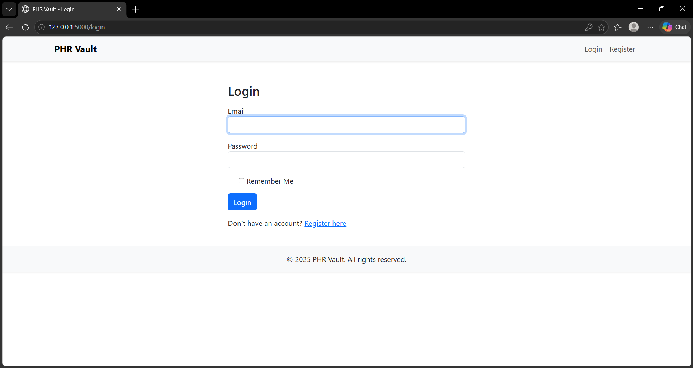
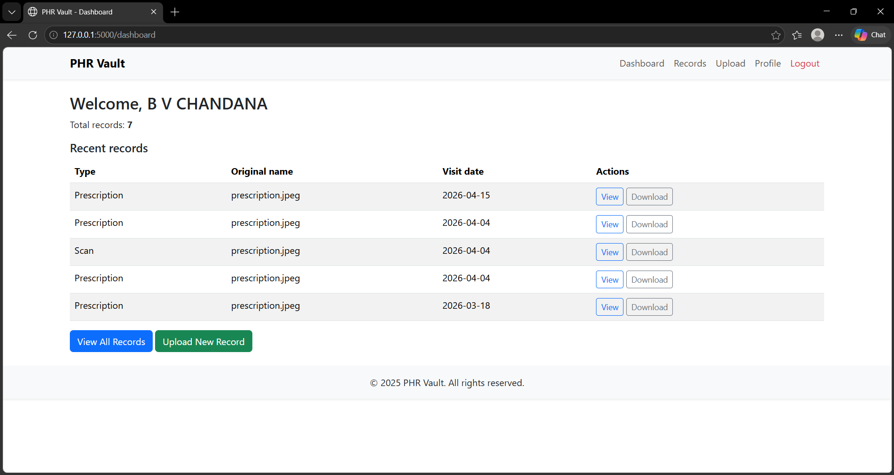
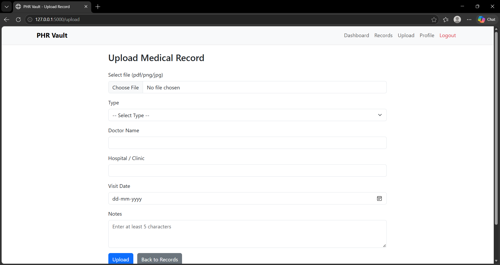
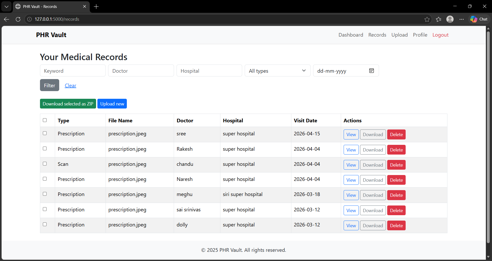

# 🏥 PHR Vault: Personal Health Record System

A web application that helps users **securely store and manage their personal health records digitally**. Users can create an account, upload medical files, and search, filter, view, and download their records from one place.


> 📅 Built Nov 2025 – Mar 2026 as a personal project.

---

## ✨ Features

- 🔐 **User authentication**: register and log in to keep records private
- 📤 **Medical file upload**: store reports, prescriptions, and other documents
- 🔎 **Search and filter**: find a record quickly
- 👁️ **View and download**: open or save any uploaded record
- 🗂️ **Record management**: update or remove records you no longer need
- 🗄️ **Structured database**: SQLite with Flask, using migrations to track schema changes

## 🖼️ Screenshots
### Login


### Dashboard


### Upload Record


### Record


## 🧰 Tech Stack

| Layer | Technology |
|:---|:---|
| Backend | Python, Flask |
| Database | SQLite (SQL) with migrations |
| Frontend | HTML, CSS, Bootstrap |

## 📁 Project Structure

```
Personal-Health-Record-/
├── app.py            # Application entry point and routes
├── config.py         # App configuration
├── forms.py          # Form definitions and validation
├── models.py         # Database models
├── utils.py          # Helper functions
├── migrations/       # Database migrations
├── templates/        # HTML templates
├── static/           # CSS, JS, and images
├── uploads/          # Uploaded files (not tracked in Git)
└── requirements.txt  # Python dependencies
```

## 🚀 Getting Started

**Requirements:** Python 3.10+

```bash
# 1. Clone the repository
git clone https://github.com/chandana165/Personal-Health-Record-.git
cd Personal-Health-Record-

# 2. Create and activate a virtual environment
python -m venv venv
venv\Scripts\activate        # Windows
# source venv/bin/activate   # macOS / Linux

# 3. Install dependencies
pip install -r requirements.txt

# 4. Run the app
python app.py
```

<!-- TODO: Confirm the run command above matches how you start the app (python app.py or flask run). -->

Then open **http://127.0.0.1:5000** in your browser.

## 🔒 Privacy and Security Notes

- This is a learning project. Do not upload real medical records to a public or shared deployment.
- Set your own secret key in your environment and never commit it to Git.
- Uploaded files and the database stay on your machine and are excluded through `.gitignore`.

## 🔮 Future Improvements

- Encrypt stored files
- Add reminders for appointments and medications
- Deploy a demo with sample data

## 👩‍💻 Author

**B V Chandana**: Full Stack Developer

[](https://linkedin.com/in/b-v-chandana-b528112b3)
[](mailto:chandanabv26@gmail.com)
[](https://github.com/chandana165)
